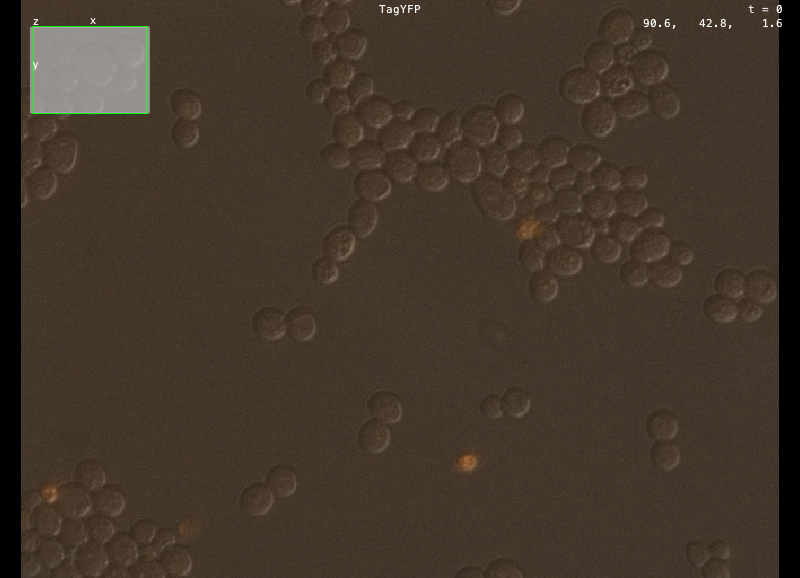

# refkv-javacpp

Java bindings to [refkv](https://github.com/d-v-b/refkv), built with [JavaCPP](https://github.com/bytedeco/javacpp),
and a read-only [N5](https://github.com/saalfeldlab/n5) `KeyValueAccess` over refkv stores, so that N5 readers
(Zarr, OME-Zarr) read foreign file formats (TIFF, HDF5, MRC, N5, CZI, ND2, ...) without copying them.

refkv *zarrifies* a file into a Zarr hierarchy whose chunks are references to byte ranges of the original file,
saved as one small archive. N5 reads that hierarchy and the chunks come from the original file on demand.

```java
// 1. zarrify (a path or http(s) URL of a file or store) into a phkv store
Zarrify.convert("volume.mrc", "volume.phkv", Zarrify.options().format(Zarrify.Container.PHKV));

// 2. open it, and give N5 a KeyValueAccess over it
try (PhkvStore store = PhkvStore.open("volume.phkv")) {
    N5Reader reader = new ZarrV3KeyValueReader(new RefkvKeyValueAccess(store), "", new GsonBuilder(), false);
    DatasetAttributes attrs = reader.getDatasetAttributes("0");
    DataBlock<?> block = reader.readBlock("0", attrs, 0, 0);   // read from volume.mrc
}
```

## Layout

| | |
|---|---|
| `refkv/` | git submodule: refkv itself, pinned to a commit |
| `capi/` | Rust crate: a C ABI over refkv's zarrify pipeline and phkv reader (refkv has no C API of its own). `build.rs` generates `capi/include/refkv.h` with cbindgen |
| `java/` | Maven project: JavaCPP presets, the generated raw bindings (`global/refkv.java`, committed), the Java API (`Zarrify`, `PhkvStore`) and `RefkvKeyValueAccess` |

JavaCPP binds C and C++, and refkv is Rust, so the path is Rust core, `capi` (`extern "C"`), `refkv.h`,
JavaCPP-generated JNI, and Java. `capi` reuses the modules of refkv's `vzip` CLI by path, since that crate is a
binary with nothing to depend on; its `convert` driver is a copy of the CLI's, and needs checking when the
submodule moves.

## Build

Everything comes from [pixi](https://pixi.sh) (OpenJDK 21, Maven, Rust, clang, CMake):

```sh
git submodule update --init
pixi run test          # builds capi, then the JNI library, then runs the Java tests
pixi run java-gen      # after changing capi's C API: regenerate global/refkv.java from the header
```

## What reads what

- **Zarrify** writes a vzip archive (the default), a standalone phkv store, or a *hybrid* (a vzip archive that
  also carries a phkv container).
- **`VzipArchive`** is a Java reader of vzip archives (spec/bindings/vzip.md), with no native code. It opens a local
  `Path` or an http(s) `URI`, and reads hybrids as vzip too.
- **`PhkvStore`** reads phkv stores and hybrids through refkv's Rust phkv reader, which is the only reader of a
  standalone phkv store. It reads the store's own records natively and resolves their references in Java, with the same
  `ReferenceResolver` and `Policy` as `VzipArchive`.
- Both implement `ReferenceStore`, which `RefkvKeyValueAccess` takes, so N5 reads either.
- `RefkvKeyValueAccess` is read-only. Directories are key prefixes.

### Opening a vzip archive

```java
// local: its sources resolve against the file, and file: sources are refused unless the policy allows them
VzipArchive a = VzipArchive.open(Path.of("volume.vzip"), Policy.filesBelow(Path.of("/data/volumes")));

// over HTTP: the tail is read with one range request, and with a page index no more of the central directory
// than a lookup needs; every source is read by range requests too
VzipArchive b = VzipArchive.open(URI.create("https://example.org/volume.vzip"), Policy.defaults());
```

```java
// a phkv store, or a hybrid archive: the same policy decides what its references may read
PhkvStore c = PhkvStore.open("volume.phkv", Policy.filesBelow(Path.of("/data/volumes")));
```

### The reader policy

A store can name any URL, so `Policy.defaults()` allows `http` and `https` only, and only public addresses
(spec/refkv.md section 6.7). Loopback, private, link-local and special addresses, other schemes (`file` included) and
proxies need `allowPrivateHosts`, `allowScheme`/`prefix`, and `allowUncheckedProxy`, each named for what it risks.
A prefix list confines `file:` sources to a directory, following symbolic links to the real path.

Known limits:
- **DNS rebinding.** The spec requires connecting only to an address the reader checked. `java.net.http.HttpClient` does
  not let a caller choose the address, so the reader resolves and checks every address just before the request and
  cannot rule out that the connection resolves the name again. For an untrusted store, use prefixes, which do not
  depend on addresses.
- **Windows paths are implemented but not run on Windows.** `file:` URLs map to drive-letter paths
  (`file:///C:/data/x` is `C:\data\x`) and, with `allowFileHosts`, to UNC paths (`file://server/share/x`), as
  spec/refkv.md section 5 says; `file:///data/x` is an error there, since it names no drive. Both the Java reader
  (`UriRef`) and the native one (`capi/src/filemap.rs`) have the rules as pure string functions, tested on every system
  (`pixi run test`, `pixi run capi-test`); the Rust read branch for non-Unix systems was compiled and run on macOS with
  its cfg swapped. The step that opens a file on Windows itself was never run, so a Windows CI job is still wanted.
  `allowFileHosts` is unsafe (reading a UNC path connects to the server, which may send the user's credentials) and
  does not confine a store to its share: `../..` can name another share of the same server, so confine it with a `prefix`.
  The native mapping (`capi/src/filemap.rs`) now serves only the unchecked native resolver above.
- **`PhkvStore` resolves references in Java**, so `PhkvStore.open(path)` refuses `file:` sources unless the policy allows
  them, as `VzipArchive` does. It used to resolve them in the native reader, which has no scheme policy and does not check
  http(s) `etag` and `modified_not_after` pins, follow redirects or validate `Content-Range` (read from
  `capi/src/resolver.rs`). That resolver is still in the C ABI as `refkv_phkv_get`, reachable as
  `PhkvStore.unsafeNativeGet`, only so that `CrossCheckTest` can compare Java resolution with an independent
  implementation: it should not be used on a store you do not trust, and could be deleted.
- A reference's reads are made one after another, and reads of different `get`s are not combined.
- A Java array holds 2^31 - 1 bytes, so `maxBytesPerGet` defaults to just under that, not the spec's 2^31.

### The choice of ZIP library

None. The reader parses the container itself, and uses the JDK's `java.util.zip.Inflater` for DEFLATE and `CRC32C`.
A vzip archive is a valid ZIP file, and both libraries tried open one: `java.util.zip.ZipFile`, and Apache Commons
Compress `ZipFile` (over a `SeekableByteChannel`, so it could be backed by HTTP). They do not fit. What was measured,
on an archive made by `Zarrify` (21 entries):

- **Both read the whole central directory at open.** Commons Compress made 132 channel reads for the 21 entries; over
  HTTP that is hundreds of requests. It also defeats the page index (spec/bindings/vzip.md section 12), which exists so
  that a lookup reads one bounded slice of the directory.
- **Neither handles a damaged record the way vzip says to.** With one record's signature corrupted, the JDK's `ZipFile`
  refuses the whole archive, and Commons Compress opens it and reports **2 of 21 entries**, dropping the other 19 keys
  without an error. For a paged archive vzip confines the damage: the reader opens, and only the page that cannot be
  parsed is an entry error (section 13.3). Without a page index it is an archive error.
- **The directory is read from the end by fixed rules:** the end record 60 or 44 bytes from the end (section 10.4),
  the entry counts ignored and the directory located only through the zip64 record (section 10.2), and a reference's
  payload taken from its record's extra field (section 11.3). Neither library does these.

`Inflater` supplies what section 13.1's "DEFLATE must end exactly at the end of the body" needs: `finished()` and
`getRemaining()`. vzip fixes every field a reader needs (body offsets come from the central directory alone and local
headers are never read), so parsing the container is a small part of the reader.

## Status

macOS arm64 only so far (`pixi.toml`'s `platforms`); the C ABI is portable, but only that platform is built and tested.
refkv itself is a proof of concept with no stability promise before 1.0.

## Demo: BigDataViewer

`demo/` opens an image in [BigDataViewer](https://imagej.net/plugins/bdv/) through a vzip archive: refkv zarrifies a file in
a foreign format, N5 reads the archive as a Zarr dataset, and BigDataViewer asks N5 for blocks, which are read from the
original file, over HTTP, as the viewer needs them. The default image is a 3-channel yeast z-stack from the
[Image Data Resource](https://idr.openmicroscopy.org/) (idr0011, CC BY 4.0, Zeiss CZI, 44 MB at the EBI), one of the examples
of the [refkv demo](https://d-v-b.github.io/refkv-demo/image-to-zarr/).

```sh
pixi run demo                                         # the image above, in BigDataViewer
pixi run demo "https://example.org/volume.vzip"       # an archive: a path or a URL
pixi run demo "/data/image.nii --files-below /data"   # a local file, zarrified first; --files-below lets the archive read it
pixi run demo "--check"                               # no window: zarrify, read a block, and wait for one volatile voxel
pixi run demo "--preview out.png"                     # no window: composite the middle plane of every channel into a PNG
pixi run demo "--screenshot out.png --wait 45"        # open the viewer, wait 45 s for blocks to load, save what it shows, exit
```

Relative paths are relative to the repository root.

What happens on the default image: zarrify reads about 250 KB of the file, in 12 requests and about 4 seconds, and writes an
archive of 18.5 KB. The archive's metadata gives BigDataViewer the voxel size (0.205 x 0.205 x 0.35 micrometers) and three
named, coloured, windowed channels (TagYFP, mRFP1.2, TL DIC). Pixels are read one plane at a time (672 x 512, 688 KB), and
that server gave about 250 KB/s, so a plane takes a few seconds to appear; to browse faster, download the file and zarrify
the local copy. Only the full resolution is shown, so a large image is slow to move through.



*BigDataViewer's own display (`--screenshot`), reading the 44 MB CZI through the 18.5 KB archive: the three channels are coloured and
windowed from the file's metadata, and the cursor readout is in micrometers. Image: IDR idr0011, CC BY 4.0.*

Status, so you know what was run:

- **The window was run, once, on macOS (Apple silicon).** Not from a plain terminal session: macOS lets only a process in
  the desktop session open a window, so it was started by opening a `.command` file with Terminal. The run zarrified the default
  image, opened BigDataViewer, waited for the blocks, and saved the screenshot above. Interaction (panning, z-scrolling, the
  channel sliders, loading speed on a slow link) was not tried, and nothing was run on Linux or Windows. `--check` runs the
  loading without a window and needs no display; `--preview` is a software composite of the pixels, also without one.
- **Only some images show.** N5 reads raw, transposed and gzip chunks of the common integer and float types, which is about half
  of the arrays in refkv's own test fixtures. JPEG, JPEG 2000 and JPEG XR tiles (the JPEG XR CZI pyramid, NDPI, VSI, QPTIFF
  and the compressed TIFFs among the demo site's examples), PackBits, and half floats are not decoded; the demo says so and
  names the codecs instead of failing obscurely. Uncompressed CZI, Imaris, NIfTI, NRRD and MRC files work.
- **One image per run:** the first OME-NGFF multiscales group of the archive, at its full resolution.
- **Windows:** `pixi.toml` and `pixi.lock` also solve for `win-64` (JDK, Maven, Rust, CMake, clang), and the `demo` task is
  written without shell scripts. Nothing has been built or run there. Rust's MSVC target needs the Visual Studio Build Tools'
  linker, which conda does not provide, and whether JavaCPP finds the import library of the Rust DLL on Windows is unchecked.

## License

Copyright (c) 2026 Howard Hughes Medical Institute.

Licensed under either of

- the BSD 3-Clause License ([LICENSE-BSD-3-Clause](LICENSE-BSD-3-Clause)), or
- the Apache License, Version 2.0 ([LICENSE-APACHE](LICENSE-APACHE)),

at your option (SPDX: `BSD-3-Clause OR Apache-2.0`).

The `refkv/` submodule is [refkv](https://github.com/d-v-b/refkv), licensed `MIT OR Apache-2.0` by its authors, and
`capi/` compiles some of its source into the native library (`capi/src/lib.rs` includes modules of its `vzip` CLI by
path). A built `librefkv_capi` therefore contains refkv's code under its terms; see `refkv/LICENSE-MIT` and
`refkv/LICENSE-APACHE`, and keep them with a binary you redistribute. The Java dependencies keep their own licenses.
